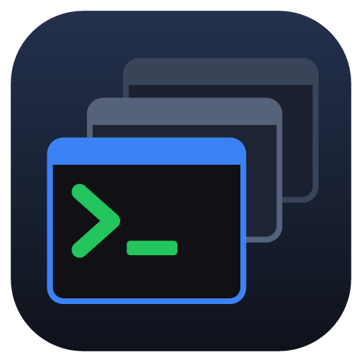

<p align="center"></p>

# BulkSSH

A Windows app for working with many SSH devices at once: servers, Raspberry Pis, routers and switches.

- **Add many devices in one go:** type `10.0.0.5, 10.0.0.6:2222, switch.local`, enter the username once, and connect them all with one password.
- **Grid of live terminals**, paged when there are more devices than fit on screen, plus a full-size **focus view** for vim, top and the like.
- **Mirror keystrokes:** typing in one terminal also types into every device you've ticked.
- **Broadcast a command** to ticked devices and see each one's output and exit code.
- **Safety:** risky commands such as `reboot` or `rm -r` need confirming before they reach several devices, and host keys are never accepted silently.
- **Saved passwords (optional)**, encrypted with your Windows account. Dropped connections **reconnect automatically**.

## Install

Download from the [latest release](https://github.com/RileyBeenders/BulkSSH/releases/latest):

- `BulkSSH-Setup-1.0.0.exe`: installer, for your user only (no admin rights needed).
- `BulkSSH-1.0.0-portable.exe`: single file, nothing to install.

The app isn't code-signed yet, so Windows SmartScreen will warn on first run: choose **More info → Run anyway**. Your devices and settings are kept in `%APPDATA%\bulkssh`.

## Quick start

1. **+ Add**: enter one or more addresses (add `:port` if it isn't 22), a username, and password or key login.
2. Devices connect straight away and appear as tiles. **Connect all** and **Disconnect all** sit at the top of the device list.
3. Tick devices in the list to choose which ones get **Mirror** keystrokes and **Run on N** broadcasts (the bottom bar).
4. **Edit list** (bottom left) selects several devices to delete at once. **⚙** opens settings.

| Keys | Does |
| --- | --- |
| Ctrl+PageUp / PageDown | Previous / next page (in focus view: previous / next device) |
| Ctrl+Shift+F | Focus view on / off |
| Ctrl+Shift+M | Mirror keystrokes on / off |
| Ctrl+Shift+C / V, right-click | Copy / paste (Ctrl+C copies only when text is selected) |

## Build from source

Needs Windows and Node.js 24+.

```bash
npm install
```

```bash
npm run dev
```

`npm test` runs the tests. `npm run dist` builds the installer and portable exe into `dist/`. `npm run dev:ssh -- --count 4` starts four fake SSH devices on `127.0.0.1:2222`–`2225` (password `dev`) for trying the app without real hardware.

Planned next: telnet, serial, and SFTP file transfer.
